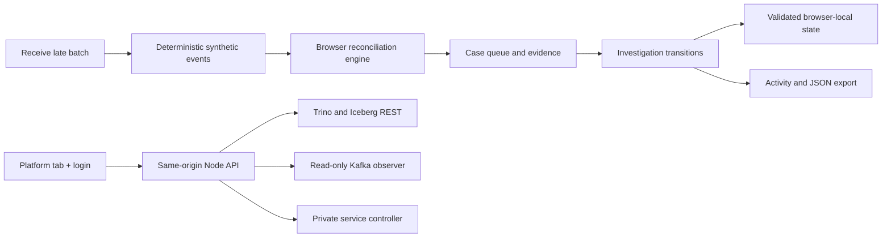

# Control Tower: design and verification

## Product boundary

The first slice covers **confirmed order → payment capture → reconciliation → investigation**.
It makes discrepancies inspectable without presenting an absent event as proof of a failed
payment. The default dataset is synthetic and labelled throughout the application. The interface
contains no customer identities or production credentials.

Shipping, inventory, provider settlement connectors, partial refunds, chargebacks, currency
conversion, tenant isolation and shared case management are not implemented in this slice.
The existing lakehouse handles additional domains; that does not mean the case engine evaluates them.

## Two explicitly separate data paths



There is intentionally **no arrow from Trino/Kafka to the synthetic case queue**. Starting the data
platform, running `make demo` or running a Kafka stress profile does not change the synthetic cases.
Those commands are observable in Platform → Live tools. Receiving the synthetic late batch does
not publish events to Kafka, modify an Iceberg table, or change a service state.

The frontend uses the repository's pinned React 19.2.8, TypeScript 6.0.3 and Vite 8.2.2 versions.
It adds no runtime dependencies. Styling uses CSS, system fonts, inline SVG icons and native meter
elements. The existing Nginx container serves the built assets and proxies authenticated platform
requests. No new backend endpoint or backend persistence service is introduced by this feature.

## Reconciliation semantics

`src/control-tower/model.ts` accepts a snapshot containing an explicit UTC cutoff, confirmed orders,
and evidence. Evaluation is pure: the same snapshot produces the same ordered findings.

1. Ignore events whose occurrence or receipt is after the cutoff. Validate timestamps and amounts.
2. Deduplicate identical event IDs; reject conflicting records with the same ID.
3. Group evidence by order and sort by business occurrence time, then synthetic offset and event ID.
4. For each payment ID, retain its latest capture or full-reversal event. Authorization alone does
   not establish a capture, and a later authorization cannot undo a reversal.
5. Sum active captures by currency using integer minor units. Never sum unlike currencies.
6. Apply the rules below. At most one primary finding is emitted per order: currency mismatch takes
   precedence over other rules. The evidence remains available even when another rule is primary.

| Rule | Condition | Priority |
| --- | --- | --- |
| Capture not observed | Positive-total order, no active capture, age ≥ 30 minutes | High at age ≥ 120 minutes; otherwise medium |
| Amount mismatch | Same-currency active captures differ from the confirmed amount | High at an absolute difference ≥ 100 units in the order currency; otherwise medium |
| Currency mismatch | Any active capture has a different currency from the order | High |

A zero-total order does not need a capture. Split captures are supported when they have distinct
payment IDs; repeated captures with the same payment ID are state updates, not independent charges.
EUR, GBP and USD are the supported two-decimal currencies. Amount strings must have exactly two
decimal places and be non-negative. Parsing uses `BigInt`, then rejects minor-unit values and totals
outside JavaScript's safe integer range. These constraints are appropriate for this fixture contract,
not a universal monetary model.

The 100-unit threshold is a demo policy, not an FX-normalized risk score. The synthetic event offsets
are identifiers within the fixture, not fetched Kafka offsets. Every event identifies partition 0
as synthetic. A live adapter would need authoritative source identity, sequence and freshness rules.

## Dataset and late-arrival scenario

`demo.ts` generates 64 confirmed orders across Italy, Germany, France, Spain and the United Kingdom.
The initial cutoff is **9 October 2026, 10:30 UTC**. It generates eight findings: four missing captures,
three amount mismatches and one currency mismatch. The other 56 orders reconcile. Initial workflow
state is New and Unassigned for every case.

**Receive next batch** appends one event: the capture for `ORD-10482` occurred at 07:30 UTC but is
received at 10:35 UTC. The cutoff advances to 10:35 and the engine finds seven discrepancies. All
eight original cases remain addressable, including their triggering evidence and investigation
history. The cleared case is not automatically resolved. The batch can be received once per reset;
there is no hidden polling timer or random result generation.

Case IDs combine order ID and rule. This fixture implementation retains the initial case set; it
is not an unbounded event-processing service or a general recurring-alert lifecycle manager.

## Investigation lifecycle

`updateCase` is a pure transition function. It validates the caller's expected revision and creates
a new record, leaving the previous record unchanged. Every successful action increments the revision
and appends a history entry. The actor is always **Demo operator**: selecting an owner selects a team,
not an authenticated identity. Live-platform login does not grant an identity to synthetic actions.

- Assign to Operations, Finance or Data engineering, or return to Unassigned.
- Start a review from New. Adding a note or assigning a team does not implicitly start a review.
- Add an investigation note containing 10–1,000 trimmed characters.
- Resolve with an assigned owner, a substantive note and an operator-verified cause.
- Dismiss with a substantive explanation. A dismissed case has no confirmed cause.
- Closed cases reject edits. Reopening requires a reason, returns to In review and clears the current
  cause while retaining the previous resolution in history.

Resolution records an operator decision; it does not mutate the original order/payment evidence or
guarantee that a provider action happened. Likewise, receiving evidence changes detection results,
not workflow status. The Overview shows these as separate measurements. Completed reviews include
Resolved and Dismissed; recorded cause counts include only current resolutions.

Evidence uses the fixed synthetic clock. Investigation actions use the actual browser clock. Both
are displayed explicitly in UTC. The Activity view records actual interaction history; it is not
a synthetic business-volume trend.

## Browser state and failure behavior

`storage.ts` validates a versioned document at `marketplace-control-tower:demo:v1` before restoring
batch state and case work. Invalid JSON, unknown statuses/owners/causes, inconsistent revision counts,
invalid histories and inconsistent resolution records are rejected. Recovery opens the initial
fixture with a visible warning, leaving the unreadable stored value intact until an explicit reset.

Before saving, the application compares the stored document with the version it loaded. A detected
change from another tab refreshes the state and rejects the stale action without discarding its note.
This is a usability guard, **not** an atomic multi-tab transaction or production concurrency control.
If storage is blocked or full, the UI reports in-memory operation. Export works without persistence.
Reloading in-memory-only changes loses them; the warning explicitly advises exporting first.

Reset requires confirmation and removes only the named demo key. It never clears all browser storage,
logs out live-platform sessions, or deletes lakehouse data. JSON export is generated locally and
includes source designation, snapshot, triggering findings and workflow history. It is not uploaded.
No credentials belong in case notes. Browser storage can be edited by the user and is not an immutable
or compliance-grade audit log.

## Interface structure

- `App.tsx`: workspace state, navigation, case filtering, summaries, stale-tab guard, export/reset.
- `CaseDetail.tsx`: selected case evidence, expandable source metadata, investigation controls/history.
- `ui.tsx` and `format.ts`: shared visual primitives and UTC date formatting.
- `tower.css`: single-page desktop layout, internal panel scrolling, responsive stacked layout,
  keyboard focus states and reduced-motion support.
- Existing `DashboardLogin`, `OperationsDashboard` and `KafkaMonitor`: authenticated live tools,
  mounted only when Platform → Live tools is selected. No `/api/` requests occur in synthetic tabs.
- Existing `ArchitectureMap` and `DeploymentPanel`: static infrastructure descriptions, not live state.

## Complete acceptance walkthrough

Run from the repository root:

```bash
[ -f .env ] || cp .env.example .env
make architecture-check
make architecture-up
```

Open <http://localhost:4173> and perform these checks:

1. Confirm Synthetic data is visible, with 64 analysed orders, eight open cases and three high-priority cases.
2. Search for `United Kingdom`; confirm the GBP order appears. Clear the search and filter High priority.
3. Select `ORD-10482`. Expand both timeline events; compare event IDs, occurrence time and receipt time.
4. Open Investigation. Try Resolve without a cause and verify that it is rejected.
5. Assign Finance, start review, add a substantive note, and confirm Activity records each action.
6. In Overview, receive the next batch. Confirm seven current signals but eight open investigations.
7. Return to `ORD-10482`. Confirm the cleared signal and the capture's 07:30 occurrence / 10:35 receipt.
8. Record the verification note, choose Ingestion delay, and resolve. Use All statuses to find the closed case.
9. Reload. Confirm assignment, status and history survived. Reopen with a reason and check the audit history.
10. Export cases. Check the JSON source is synthetic and it includes original evidence and case histories.
11. Open two browser tabs, change a case in one and try to save from the stale tab. Confirm the stale action is rejected.
12. Reset and confirm the workspace returns to its initial state. Check mobile layout and keyboard navigation.

### Automated browser acceptance

The checked-in browser script drives the built site without requiring the lakehouse. It covers search,
priority/status filters, invalid resolution, assignment/review/resolution/reopening, persistence,
late evidence, export contents, stale-tab protection, corrupt-state recovery and responsive overflow.
It also checks for uncaught page errors and ensures synthetic views never call the live API.

```bash
python3 -m venv tmp/control-tower-browser
tmp/control-tower-browser/bin/pip install playwright==1.63.0
tmp/control-tower-browser/bin/playwright install --with-deps chromium
tmp/control-tower-browser/bin/python architecture-site/tests/browser_smoke.py --url http://localhost:4173
```

Browser system dependency installation can require administrator privileges. Screenshots and the
downloaded synthetic report are written to ignored `artifacts/control-tower/`. The browser test is
opt-in; the existing `make architecture-check` / CI gate runs Vitest, ESLint, strict TypeScript and
both production builds. `model.test.ts` tests monetary limits, grace-period boundaries, split captures,
duplicates, out-of-order/reversed/late evidence, currencies, workflow validation and storage parsing.

### Live infrastructure verification

```bash
make dashboard-up
make demo
# Optional: generate correlated activity for the live Kafka observer
make simulate SIMULATION_PROFILE=smoke
```

Open Platform → Live tools, use the [local dashboard credentials](../README.md#local-credentials-and-authentication),
start Trino, inspect the catalog and run a bounded read-only query. Watch Kafka topic arrivals.
The reconciliation cases remain synthetic. No website publishing or Pages enablement is required.

## Requirements before connecting real operations

Introduce a backend case store with transactional optimistic locking, idempotent ingestion and
durable audit history; authenticated user/tenant permissions; versioned rule evaluation; complete,
snapshot-consistent order/payment evidence; source lag and completeness checks; provider-specific
capture/refund semantics; and recurring-case handling. Add server-side authorization and validation
for every transition, retention/redaction controls, monitoring and recovery tests. Validate policies
with operations and finance before treating any signal as an actionable financial conclusion.

The existing lakehouse and service-control security do not supply these missing case-management
guarantees. This branch is a functional, bounded product slice, not a production reconciliation service.
